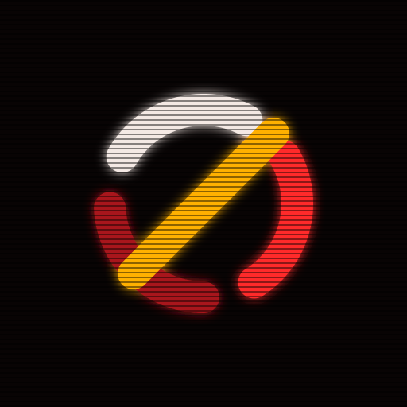

<p align="center">
  
</p>

<h1 align="center">pustka</h1>

<p align="center"><b>pustka</b> <i>(Polish, noun)</i>: emptiness, the void.</p>

<p align="center">
  <a href="https://pustka.sh">pustka.sh</a> ·
  <a href="https://github.com/pustka-sh">github.com/pustka-projects</a>
</p>

---

This repo is the single source of truth for the pustka identity: name, logo, colors, type, effects, and every asset file. If you're building anything under the pustka name, pull from here.

## Name

| | |
|---|---|
| **Name** | pustka, always lowercase |
| **Meaning** | Polish for "emptiness" or "the void" |
| **Pronunciation** | POOST-kah |
| **Domain** | `pustka.sh` |
| **GitHub** | `pustka-projects` |
| **Project subdomains** | `<project>.pustka.sh` |

## Logo

The mark is an **empty set (∅)**, the math symbol for "nothing," which is exactly what *pustka* means. The ring is split into three segments in Bone, Redline and Ember, crossed by an Alert slash, with a neon glow and CRT scanlines on a Void background.

| File | Use it for |
|---|---|
| `assets/logo/pustka-ring.svg` | Main logo, with background, glow and scanlines |
| `assets/logo/pustka-ring-clean.svg` | Same, without scanlines. Use below 64px |
| `assets/logo/pustka-mark.svg` | Mark only on a transparent background, for placing on Void surfaces |
| `assets/png/pustka-avatar-1024.png` | GitHub org avatar, profile pictures (also 512 and 256) |
| `assets/png/pustka-mark-transparent-1024.png` | Mark only, transparent PNG |
| `assets/png/social-preview.png` | GitHub repo social preview, 1280×640 |
| `assets/favicon/` | Website icons (see [Favicons](#favicons)) |

### Usage rules

- **Background:** always on Void (`#080404`) or another near-black. The mark is not designed for light backgrounds.
- **Clear space:** keep empty space around the mark of at least one ring thickness on every side.
- **Minimum size:** 16px. Below 64px, use the clean version without scanlines.
- **Don't:** rotate it, stretch it, swap in colors from outside the palette, or remove the slash.

## Colors

The palette is called **Redline**.

| Swatch | Name | Hex | Role | Contrast on Void |
|---|---|---|---|---|
|  | **Void** | `#080404` | Background. Every surface starts here | n/a |
|  | **Bone** | `#F4E9E4` | Primary text, top ring segment | 17.1:1, any text |
|  | **Redline** | `#FF2A2A` | Primary accent, links, right ring segment | 5.5:1, any text |
|  | **Ember** | `#A8161A` | Borders, shadows, bottom ring segment | 2.7:1, decoration only, never text |
|  | **Alert** | `#FFB000` | Warnings, calls to action, the slash | 11.1:1, any text |

Use Alert sparingly. It's the one warm signal color, and it loses its punch if it's everywhere.

Machine-readable versions live in [`tokens/colors.json`](tokens/colors.json) and [`tokens/theme.css`](tokens/theme.css).

## Typography

| | |
|---|---|
| **Typeface** | [JetBrains Mono](https://fonts.google.com/specimen/JetBrains+Mono) (SIL Open Font License) |
| **Display weight** | 800 |
| **Body weight** | 400 |
| **Fallback** | `ui-monospace, SFMono-Regular, Menlo, Consolas, monospace` |

Everything is monospace. pustka lives in the terminal.

## Effects

Two effects give pustka its hacker look. Use them on the logo and on hero or display elements, not on body text.

**Neon glow:** a blur of the shape layered under the original.
- SVG: `feGaussianBlur stdDeviation="7"` (at a 512px canvas), merged under the source graphic
- CSS: `text-shadow: 0 0 22px currentColor;` (class `.pustka-glow` in `theme.css`)

**CRT scanlines:** thin dark horizontal lines over everything.
- 2px black lines at 45% opacity, repeating every 6px
- CSS: class `.pustka-scanlines` in `theme.css`

## Using the theme

```css
@import "tokens/theme.css";

body {
  background: var(--pustka-bg);
  color: var(--pustka-text);
  font-family: var(--pustka-font);
}
a { color: var(--pustka-accent); }
```

## Favicons

Copy `assets/favicon/` to your site root and add:

```html
<link rel="icon" href="/favicon.ico" sizes="48x48">
<link rel="icon" href="/icon-192.png" type="image/png" sizes="192x192">
<link rel="apple-touch-icon" href="/apple-touch-icon.png">
<meta name="theme-color" content="#080404">
```

## Logo geometry

For rebuilding the mark from scratch. All values are in a 360×360 box, centered inside a 512×512 canvas.

| Part | Spec |
|---|---|
| Ring | Center (180, 180), radius 118, stroke 40, round caps |
| Segments | Three arcs, each 180 units long, rotated −150° (Bone), −30° (Redline), 90° (Ember) |
| Slash | From (92, 268) to (268, 92), stroke 40, round caps, Alert, drawn on top |
| Glow | Gaussian blur, standard deviation 7, merged under the shapes |

## Repo layout

```
pustka/
├── README.md
├── assets/
│   ├── logo/          SVG source files
│   ├── png/           Avatars, transparent mark, social preview
│   ├── favicon/       Website icons
│   ├── swatches/      Color chips used in this README
│   └── social-preview.svg
└── tokens/
    ├── colors.json    Colors, effects and type as data
    └── theme.css      Drop-in CSS variables and effect classes
```
